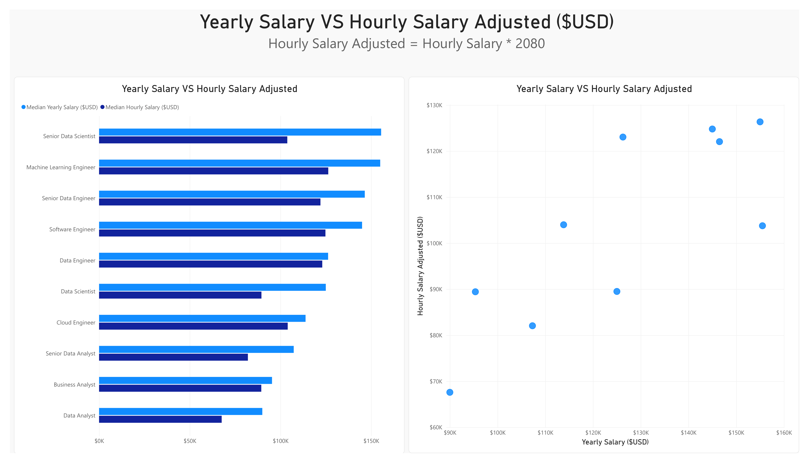
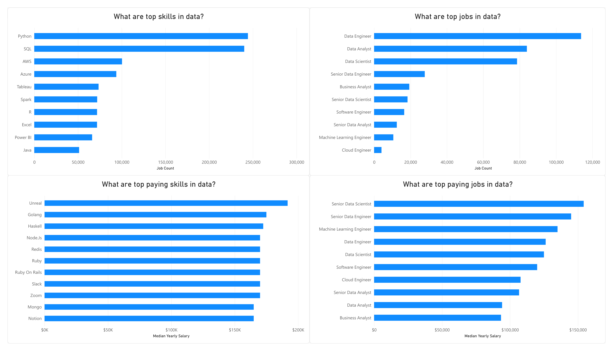
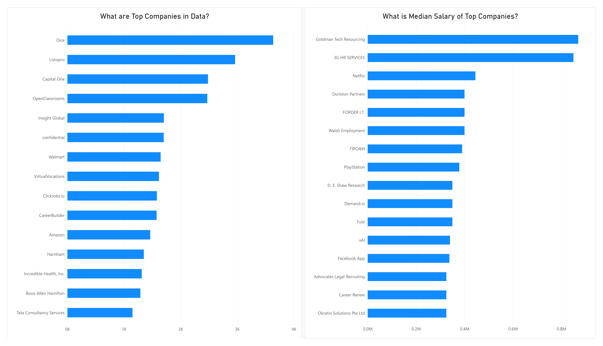
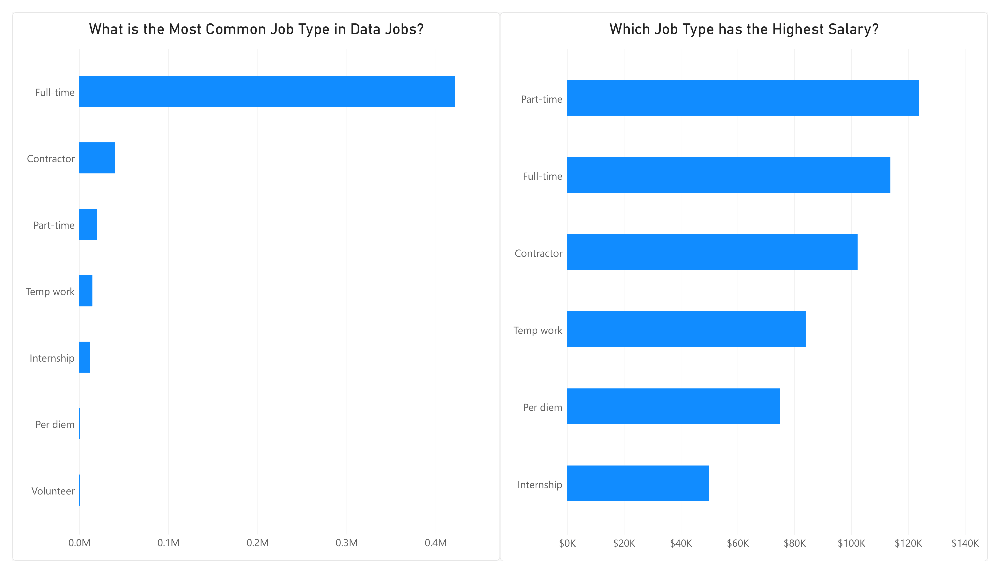
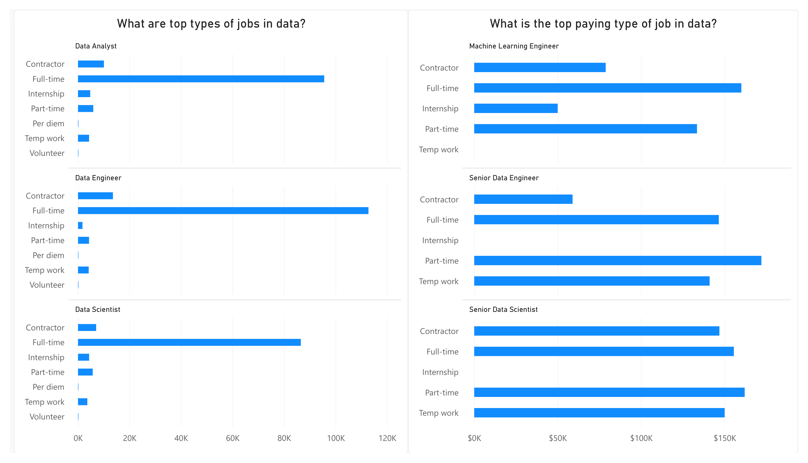
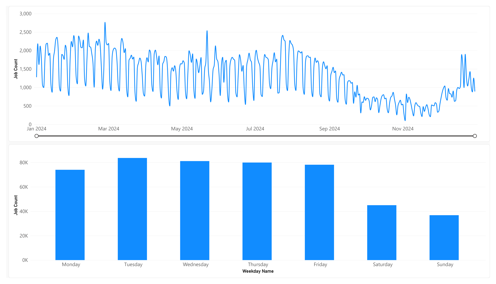
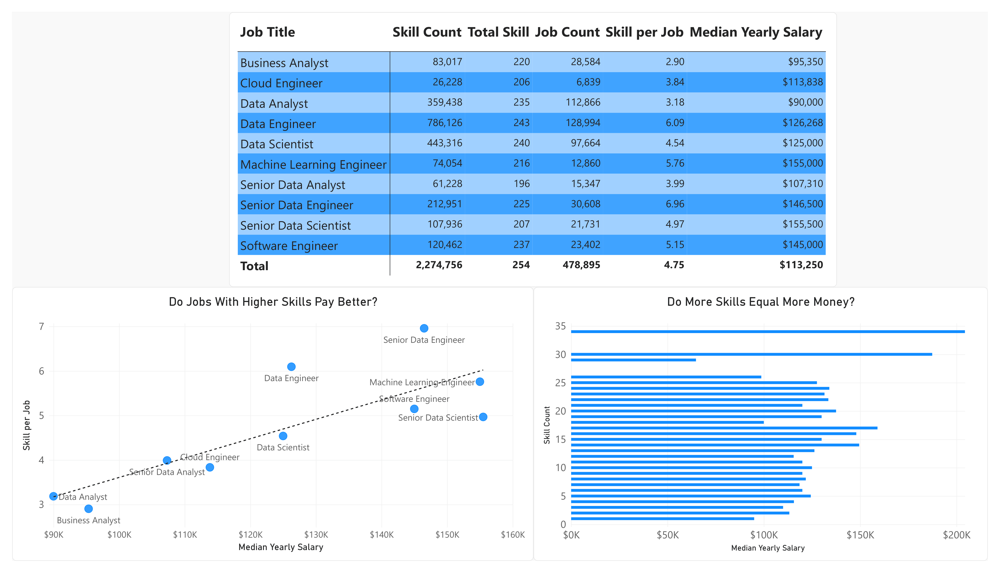
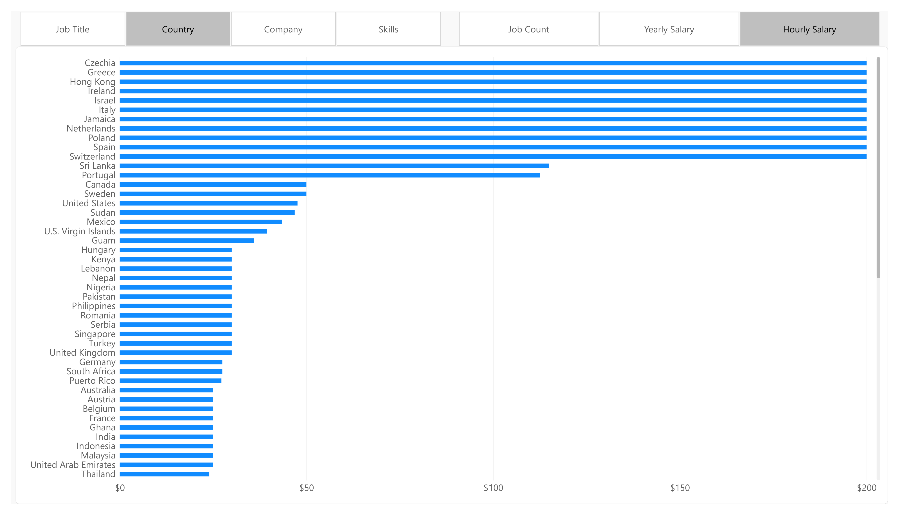
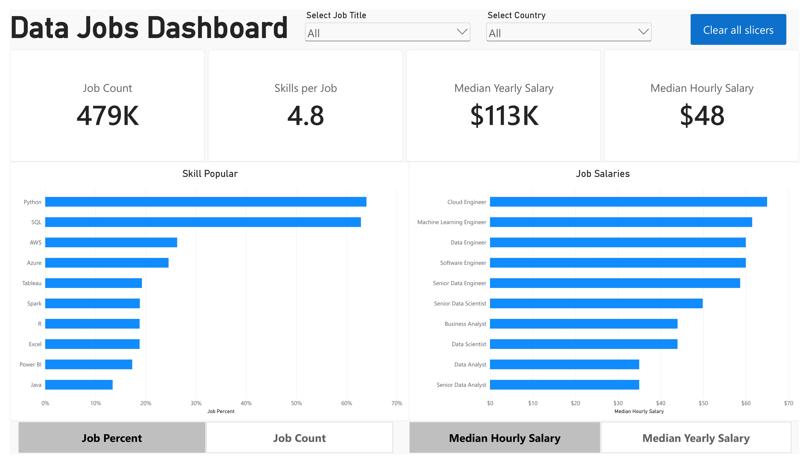

# Power Query & DAX: skill analysis, companies, and salary data jobs

Data lowongan diimpor dari folder CSV, dibersihkan dengan **Power Query (M)**, dimodelkan sebagai **star schema**, lalu dianalisis lewat ukuran **DAX** dan **field parameter** di dashboard Power BI (9 halaman). Screenshot di bawah diambil langsung dari tiap halaman laporan.

## Dataset

Folder `star_schema_files` (CSV):

- `job_postings_fact` : **478.895** lowongan (fakta)
- `company_dim` : 98.372 perusahaan
- `skills_dim` : 254 skill
- `skills_job_dim` : 2.274.756 baris relasi lowongan-skill
- `schedule_dim` : dibuat dari tabel fakta (jadwal gabungan dipecah menjadi baris)
- `date_dim` : dibuat dengan DAX

### 1. Yearly vs Hourly Salary Adjusted

Kolom terhitung `Hourly Salary Adjusted = Hourly Salary * 2080` dipakai supaya gaji per jam bisa dibandingkan langsung dengan gaji tahunan (2080 = 40 jam × 52 minggu).

**Temuan utama:**

- Bar chart kiri menunjukkan urutan yang konsisten di kedua metrik: **Senior Data Scientist** dan **Machine Learning Engineer** teratas, **Data Analyst** terbawah — gaji per jam yang disetahunkan (biru gelap) mengikuti pola yang hampir sama dengan gaji tahunan (biru terang) untuk sebagian besar jabatan.
- Scatter kanan memperlihatkan beberapa jabatan menyimpang dari pola linear: satu titik di sekitar $155 rb tahunan punya gaji per jam disetahunkan hanya ~$103 rb (jauh di bawah titik lain di kisaran gaji tahunan serupa yang mencapai ~$126 rb), menandakan gaji per jam dan gaji tahunan untuk jabatan itu tidak dilaporkan oleh populasi lowongan yang sama.

### 2. Skill dan Job Paling Diminta & Bergaji Tinggi

File: [`skills_dim.m`](power-query/skills_dim.m), [`skills_job_dim.m`](power-query/skills_job_dim.m)

**Temuan utama:**

- **Python** dan **SQL** jauh mengungguli skill lain dari sisi jumlah lowongan (masing-masing mendekati 250 ribu), sementara AWS dan Azure di kisaran 90–100 ribu — hampir dua setengah kali lebih jarang.
- Dari sisi jabatan, **Data Engineer** lowongannya paling banyak (>110 ribu), disusul Data Analyst dan Data Scientist yang hampir sama jumlahnya (~80 ribu).
- Skill dengan gaji median tertinggi (Unreal, Golang, Haskell, Node.js, dst.) semuanya bukan skill data-science klasik — ini kemungkinan skill software engineering umum yang jarang dipakai tapi mahal, bukan representasi skill data yang paling bernilai.
- Untuk job, **Senior Data Scientist** dan **Senior Data Engineer** dua jabatan bergaji tertinggi, sementara **Business Analyst** dan **Data Analyst** dua yang terendah — sejalan dengan halaman 1.

### 3. Perusahaan

File: [`company_dim.m`](power-query/company_dim.m), [`job_postings_fact.m`](power-query/job_postings_fact.m)

**Temuan utama:**

- Perusahaan dengan lowongan terbanyak (kiri) didominasi situs lowongan/perekrut — **Dice** di puncak (hampir 4 ribu lowongan), diikuti Listopro, Capital One, dan OpenClassrooms — bukan pemberi kerja akhir dalam banyak kasus.
- Median gaji tertinggi per perusahaan (kanan) justru diisi nama-nama berbeda dari daftar kiri — **Goldman Tech Resourcing** dan **3G HR Services** memimpin dengan median mendekati $0,8 juta, jauh di atas Netflix dan nama-nama lain di bawahnya (~$0,2–0,4 juta) — menandakan dua chart ini menjawab pertanyaan yang berbeda (volume vs gaji) dan tidak boleh dibaca sebagai satu daftar "perusahaan terbaik".
- Skala sumbu kanan dalam **juta USD**, jauh lebih tinggi dari median gaji keseluruhan ($113 rb) — kemungkinan dipengaruhi outlier atau lowongan bergaji sangat tinggi dengan sampel kecil per perusahaan.

### 4. Jenis Pekerjaan

File: [`schedule_dim.m`](power-query/schedule_dim.m)

**Temuan utama:**

- **Full-time** mendominasi jumlah lowongan (>0,4 juta), jauh di atas Contractor, Part-time, Temp work, Internship, Per diem, dan Volunteer yang masing-masing jauh lebih kecil (bar-nya hampir tidak terlihat pada skala yang sama).
- Namun dari sisi gaji, **Part-time** justru tertinggi (~$120 rb), sedikit di atas Full-time, lalu Contractor, Temp work, Per diem, dan Internship terendah — menegaskan bahwa jenis pekerjaan paling umum (Full-time) bukan yang bergaji tertinggi.

### 5. Rincian Jenis Pekerjaan per Jabatan

**Temuan utama:**

- Untuk Data Analyst, Data Engineer, dan Data Scientist, pola jenis pekerjaannya serupa: **Full-time** mendominasi hampir seluruh lowongan, sisanya (Contractor, Part-time, Temp work) jauh lebih kecil.
- Untuk jabatan senior (Machine Learning Engineer, Senior Data Engineer, Senior Data Scientist) di kanan, urutan gaji tertinggi per jenis pekerjaan justru sering dipegang oleh **Part-time** atau **Temp work**, bukan Full-time — konsisten dengan temuan halaman 4 bahwa jenis pekerjaan non-standar cenderung bergaji lebih tinggi per lowongan yang tercatat, meski jumlah lowongannya sedikit.
- **Internship** dan **Per diem** hampir tidak muncul sama sekali untuk jabatan senior — masuk akal karena posisi magang/harian biasanya bukan level senior.

### 6. Tren Lowongan 2024 dan Pola Mingguan

**Temuan utama:**

- Grafik harian (atas) menunjukkan pola yang sangat jelas sepanjang tahun — lonjakan tajam tiap beberapa hari lalu turun — dengan level keseluruhan menurun dari awal tahun (puncak >2.700 di Februari-Maret) ke titik terendah sekitar Oktober-November (di bawah 500), sebelum naik lagi di akhir Desember.
- Bar mingguan (bawah) menegaskan itu: **Selasa** adalah hari dengan lowongan terbanyak (>80 ribu), disusul Rabu dan Kamis, sementara **Sabtu dan Minggu turun tajam** (masing-masing di bawah 50 ribu dan 40 ribu), lowongan data jelas mengikuti pola hari kerja.

### 7. Tabel Skill per Jabatan & Hubungan Skill-Gaji

File: [`measures.dax`](dax/measures.dax)

**Temuan utama:**

- Tabel menunjukkan **Data Engineer** total skill tersebut paling banyak (786.126, skill per job 6,09) sementara **Business Analyst** paling sedikit (83.017, skill per job 2,90); total keseluruhan 4,75 skill per lowongan.
- Scatter "Do Jobs With Higher Skills Pay Better?" memperlihatkan tren naik yang cukup jelas (garis putus-putus), tapi **Senior Data Scientist** menyimpang: gaji mediannya tertinggi (~$155 rb) meski skill per job-nya (4,97) lebih rendah dari Senior Data Engineer (6,96) — menunjukkan level jabatan/seniority berpengaruh lebih besar terhadap gaji daripada semata jumlah skill yang diminta.
- Bar "Do More Skills Equal More Money?" menunjukkan pola tidak linear: lowongan dengan skill count sangat tinggi (30-34) memang bergaji tertinggi (~$200 rb), tapi di rentang tengah (5-25 skill) hubungannya tidak monoton naik — beberapa titik dengan skill lebih sedikit bergaji lebih tinggi dari titik dengan skill lebih banyak.

### 8. Field Parameter — Negara berdasarkan Gaji per Jam

Halaman ini mendemonstrasikan **field parameter**: tab di atas (Job Title, Country, Company, Skills, Job Count, Yearly Salary, Hourly Salary) mengganti dimensi/metrik chart yang sama tanpa membuat visual baru.

**Temuan utama:**

- Saat difilter ke "Country" x "Hourly Salary", sekitar 10 negara (Czechia, Greece, Hong Kong, Ireland, Israel, Italy, Jamaica, Netherlands, Poland, Spain, Switzerland) menunjukkan bar yang hampir menyentuh $200 — jauh lebih tinggi dari United States (~$45) dan sebagian besar negara lain di bawah $30.
- Nilai yang seragam-tinggi untuk banyak negara sekaligus ini kemungkinan besar **artefak sampel kecil** (mungkin hanya satu atau dua lowongan bergaji sangat tinggi per negara), bukan gambaran pasar gaji riil di negara-negara tersebut — perlu difilter dengan jumlah lowongan minimum sebelum dipakai sebagai kesimpulan.

### 9. Dashboard

**Temuan utama:**

- Empat card di atas: **479K** lowongan, **4,8** skill per lowongan, median gaji tahunan **$113K**, median per jam **$48**. Dashboard punya slicer "Select Job Title" dan "Select Country" plus tombol "Clear all slicers".
- "Skill Popular" (kiri) menegaskan Python dan SQL di atas 60% lowongan, jauh di atas skill lain seperti AWS (~27%) dan Azure (~25%).
- "Job Salaries" (kanan, diukur per jam) dipimpin **Cloud Engineer**, bukan Machine Learning Engineer atau Data Engineer seperti pada metrik gaji tahunan di halaman-halaman sebelumnya — menunjukkan urutan jabatan "bergaji tertinggi" bisa berubah tergantung metrik (tahunan vs per jam) yang dipakai.

